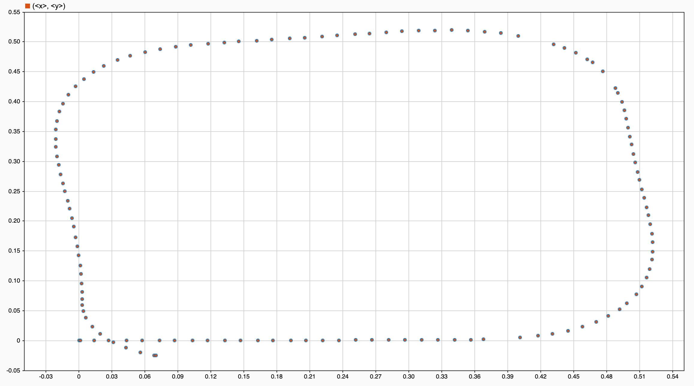
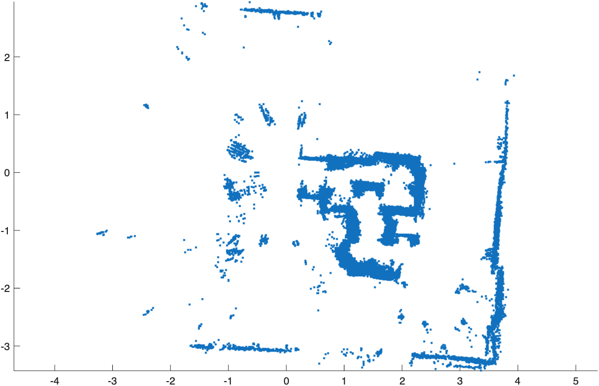
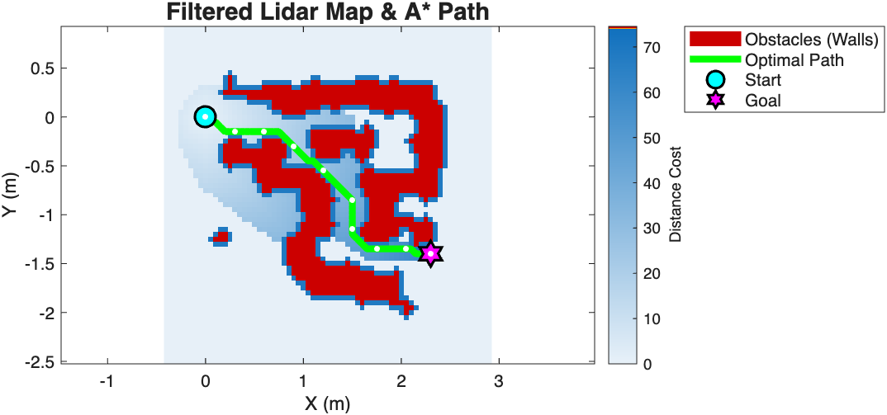
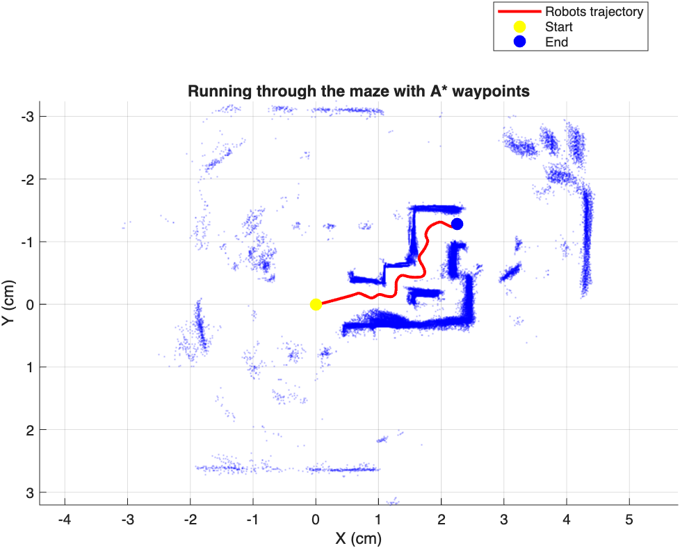

# Robot Control and Path Planning in MATLAB/Simulink

Motion control for a **TurtleBot3** ground robot and a **Crazyflie** quadcopter, followed by
lidar-based **mapping and A\* path planning**, built in MATLAB/Simulink and run on the real
robots through ROS. Course: *Robotics* (R7010E), Luleå University of Technology, 2025–2026.

**Stack:** MATLAB · Simulink · ROS Toolbox · Robotics System Toolbox · TurtleBot3 Burger · Crazyflie 2.x

## Projects

| Folder | Topic | What we built |
|---|---|---|
| [`lab2-mobile-robot-control/`](lab2-mobile-robot-control) | Mobile robot motion and control | Go-to-goal and pose controllers, line following, square / sine / figure-of-six trajectory tracking (`mstraj`), wall following on an uneven wall |
| [`lab3-crazyflie-drone/`](lab3-crazyflie-drone) | Aerial robotics | Crazyflie hovering with disturbance recovery, pose-to-pose control (position + yaw), and 3D trajectory tracking in the motion-capture lab, with a live 3D plot of the flown path |
| [`lab4-mapping-path-planning/`](lab4-mapping-path-planning) | Obstacle avoidance, mapping and planning | Reactive obstacle avoidance and Bug2; occupancy map built from teleoperated lidar scans; standalone A\* planner and trajectory following through a maze |

## Results

| Trajectory tracking on the TurtleBot (measured vs. goal) | Occupancy map from lidar points |
|---|---|
|  |  |

| A\* path through the mapped maze | Path followed by the robot |
|---|---|
|  |  |

## Run it

1. Open MATLAB (R2024b or newer) with Simulink, ROS Toolbox and Robotics System Toolbox.
2. Add the repository root to the path (it holds `+bus_conv_fcns`, the ROS message converters).
3. Open a model, e.g. `lab4-mapping-path-planning/Lab4_Task_3_final.slx`, set the robot's ROS
   domain / IP, and run. The A\* planner runs on its own with
   `lab4-mapping-path-planning/astar_path_planner.m`.

## Team

Lab work done as a team at Luleå University of Technology, including Abdalrahman Nasser and
Dominic Addo.
